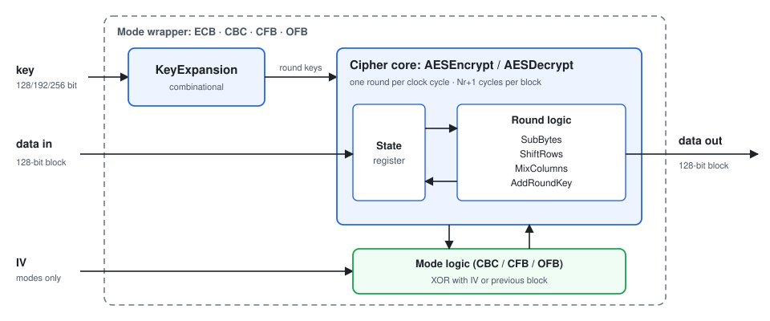

# 02201 Agile Hardware Design project
# Group 1 - Advanced Encryption Standard

This repository is for the group project in the course [02201 Agile Hardware Design](https://kurser.dtu.dk/course/02201) at the Technical University of Denmark (DTU).

The project is written using the Chisel3 library for Scala, to implement the Advanced Encryption Standard (AES) as defined in the specification published by the National Institute of Standards and Technology (NIST) [^1].
To ensure correctness of the implementation, the validation suite published by NIST [^2], was used as our 'golden model' to compare against, for the different algorithm operating modes that we implemented.

## Introduction / Motivation
Our goal was to see how cryptography standards works when it is built as a hardware. We picked AES because it is the most popular, it is used almost everywhere: in Wi-Fi, in website with HTTPS, and to protect data on disks. What we liked is that the whole algorithm is built from a few simple steps: replacing bytes, moving rows, mixing columns and XOR operations with key. These steps fit well with what hardware is good at.

Instead of building one fixed AES circuit, we wrote a generator in Chisel. You can choose the key size, mode, and the generator builds matching hardware for encryption and decryption.

#### Group Members:
- Timothy Canev (s263982)
- Emre Ertug (s252614)
- Johan Hägg Friis-Hasché (s265287)
- Jakub Koziara (s263983)
- Zbigniew Kruszwic (s263978)

## Features
The key features are outlined below, in no particular order:
- **Configurable key size**: the key size (128, 192 or 256 bits) is a design parameter. The generator builds the right hardware for each size, with 10, 12 or 14 rounds.
- **Encryption core**: encrypts one 128bit block. It does one AES round per clock cycle, so one block takes `Nr + 1` cycles.
- **Decryption core**: by using the inverse steps in reverse order we can get the original data back.
- **Key expansion**: turns the user's key into all round keys at once, so every round key is ready right away.
- **Operating modes**: besides plain single-block encryption (ECB), the project supports CBC, CFB (8bit and 128bit) and OFB modes established by NIST.
- **Ready/valid interface**: every module uses a simple valid/ready handshake, so blocks can be sent one after another without extra waiting.
- **Testing against official data**: our design is tested with unit tests, random tests against software model and Java built-in AES, and official NIST files.
- **Continuous integration**: all tests run automatically on GitHub Actions for every pull request.

## Dependencies
To build the project and run the tests you only need:
- **Java (JDK) 17 or newer**. GitHub Actions uses Temurin 17, and Temurin 21 used locally.
- **sbt**, the Scala build tool. The project uses sbt 2.0.8.


| Library | Version | Used for |
|---|---|---|
| Scala | 2.13.16 | Language |
| Chisel | 6.7.0 | Hardware description |
| ChiselTest | 6.0.0 | Simulation and testing |
| ScalaTest + ScalaCheck (`scalacheck-1-18`) | 3.2.19.0 | Unit tests and random tests |

No separate simulator is needed: ChiselTest uses Treadle a simulator that runs inside JVM.

## Running the project
TODO

### Running the tests
Run all tests from the root of the repository:
```
sbt testFull
```
In sbt 2, `sbt test` only runs tests failed on the last run or codes that has changed since, so if the project hasn't changed it will prompt 0 tests were run. `sbt testFull` always runs everything. On GitHub Actions every run starts from a clean copy, so `sbt test` runs everything there.

Run single test file, or the tests in it whose name contains some text:
```
sbt "testOnly AESEncryptSpec"
sbt "testOnly AESCFBSpec -- -z NIST"
```

By default only first records of the NIST Monte Carlo tests is run because it takes a lot of time. In order to run them all, set `AES_FULL_MCT=1` (in PowerShell: `$env:AES_FULL_MCT=1`) before starting sbt:
```
AES_FULL_MCT=1 sbt testFull
```
sbt 2 keeps a server running in the background, and the server keeps the environment it was started with. If it was already running, stop it first with `sbt shutdown`, otherwise the variable is not seen.

The test files are in `src/test/scala`. Each module has its own test file named after it, for example `SubBytesSpec` for `SubBytes`, `AESDecryptSpec` for `AESDecrypt` and `AESCFBSpec` for `AESCFB`. `AESSpec` tests `KeyExpansion` and `AESEncrypt` together, and `AESReference.scala` holds the software models and the reader for the NIST files.

### Generating Verilog
TODO

### Running on the FPGA
TODO

## Implementation details
### Overview

The cipher goes into `KeyExpansion` module which turns it into all the round keys at once. The data block (128bits) goes into the cipher core. The core keeps the block in a state register and runs it through one AES round per clock cycle, so a full block takes `Nr + 1` cycles.
Same core structure is used for encryption (`AESEncrypt`) and, with the inverse steps, for decryption (`AESDecrypt`). Around the core, a mode wrapper adds the logic for different operational modes.

### AES
AES is a symmetric encryption algorithm. It works on blocks of 128 bits, with three key sizes(128, 192, 256). And key length determine the number of rounds `Nr` will be performed.

| Version | Key length | Rounds (`Nr`) | Round keys |
|---|---|---|---|
| 128-AES | 128 bits | 10 | 11 |
| 192-AES | 192 bits | 12 | 13 |
| 256-AES | 256 bits | 14 | 15 |

Encrypting a block starts with `AddRoundKey` (round 0). Then follow `Nr` rounds of `SubBytes`, `ShiftRows`, `MixColumns` and `AddRoundKey`, where the last round skips `MixColumns`. Every round uses its own round key, so `Nr + 1` round keys are needed, and `KeyExpansion` makes them from the key. Decryption does the same steps backwards, with the inverse of each step.

The parts below follow this order: how a block is stored, the round steps, the key expansion, and then the two cores that put them together.
#### State representation
AES works on a 4x4 grid of bytes called the State. In Chisel this is the `State` bundle: 4 rows of 4 bytes, so every round operation can reach a byte as `rows(r)(c)`.

Outside the cores the data is a plain 128-bit `UInt`. `AESBlock` converts between the two, following FIPS-197 [^1]: byte `n` of the block goes to row `n % 4`, column `n / 4`, so the grid is filled column by column. Byte 0 is the most significant byte, the same order as in the NIST hex strings, and keys use the same order.
#### Round operations
Each AES round is built from four steps. Every step is its own module with a `State` in and a `State` out, and decryption uses the inverse of each step:

| Step | What it does | Inverse |
|---|---|---|
| `SubBytes` | Replaces every byte with its value from the S-box | `InvSubBytes`, uses the inverse S-box |
| `ShiftRows` | Rotates row `r` to the left by `r` bytes. It is only wiring, no logic | `InvShiftRows`, rotates to the right |
| `MixColumns` | Multiplies every column with a fixed matrix in GF(2^8), using only shifts and XOR (`xtime`) | `InvMixColumns`, multiplies with the inverse matrix (14, 11, 13, 9) |
| `AddRoundKey` | XORs the state with the round key | Itself, because XOR undoes itself |

Our inital S-box looked bytes up with `VecInit(table)(index)`. The simulator evaluated this as a long chain of multiplexers, which slowed down the test. Now the 256 values are packed into one 2048-bit constant and a byte is looked up by shifting it (`packed >> (index * 8)`). It gives the same 256 values, but in simulation it's much faster.
#### Key expansion
The `KeyExpansion` module turns the cypher key into `Nr + 1` round keys (11 for 128-AES), following FIPS-197 [^1]. 

The key size (128, 192 or 256 bits) is a parameter, so one generator covers three versions. Wrong sizes are rejected when the hardware is generated.

The module is combinational, so all round keys are ready at once. This makes decryption easier, because it needs keys in reverse. Cost of that is more S-boxes (40 for 128-AES) and little longer logic path.
It's tested with the FIPS-197 examples and with random keys against software model.
#### Encryption core
`AESEncrypt` encrypts one 128-bit block, following the Cipher in FIPS-197 [^1]. It is iterative: there is one copy of the round logic, and the block goes through it once per clock cycle.

- When a block is accepted (`in.fire`), round 0 is done right away. It is only `AddRoundKey` with the first round key, and the result is stored in the state register.
- In the next `Nr` cycles the state goes through `SubBytes`, `ShiftRows`, `MixColumns` and `AddRoundKey`, one round per cycle, and a round counter picks the round key. The last round skips `MixColumns`, a multiplexer takes the `ShiftRows` output instead.
- After `Nr + 1` cycles (11 for 128-AES) the ciphertext is in the state register and `out.valid` goes high.

The key size only changes the number of rounds (10, 12 or 14), so the same core works for all three key sizes. The round keys come from `KeyExpansion` and have to stay the same while a block is being encrypted.

Core won't take a new block while it is busy. The ciphertext wait on the output until it is taken. Next block can enter the same cycle when the result leaves so there are no empty cycles between blocks. One block every `Nr + 1` cycles, that is around 11.6 bits per cycle for the 128-AES. One round per cycle is a trade off, a fully unrolled design would encrypt one block every cycle but then it would need `Nr` copies of the round logic. It would be faster but also requires more hardware to implement.
#### Decryption core
`AESDecrypt` follows the Inverse Cipher in FIPS-197 [^1]. It has the same structure but every step is inversed and the round keys are used in reverse order.

Round 0 is `AddRoundKey` with the last round key. Following that, one cycle each round does `InvShiftRows`, `InvSubBytes`, `AddRoundKey` and `InvMixColumns`, and the last round skips `InvMixColumns`. Round `r` uses round key `Nr - r`. Because `KeyExpansion` gives all the round keys at once, using them in reverse needs no extra hardware, the core just picks them from the other end.

FIPS-197 also describes an Equivalent Inverse Cipher, which keeps the same order of steps as encryption but needs `InvMixColumns` applied to the round keys. We chose the direct version, so both cores can use the round keys from `KeyExpansion` without changes.

Besides the NIST files, one test connects `KeyExpansion`, `AESEncrypt` and `AESDecrypt` in a row and checks that random blocks come out unchanged for all three key sizes.

### Operating modes
The cores only encrypt or decrypt one 128-bit block at a time. To use AES on longer messages a mode of operation is needed, which says how the blocks are connected to each other. NIST SP 800-38A [^4] describes the modes, and we implemented ECB, CBC, CFB and OFB.

Every mode (except ECB) is its own module built around the cores, and they all have the same kind of interface. `key` and `iv` are inputs that have to stay the same during a message, the data goes in and out with ready/valid, and every block has a `first` flag which starts a new message from the IV. CBC and CFB also have a `decrypt` input. OFB doesn't need one, since encrypting and decrypting is the same operation there.

| Mode | Module | Cores used | Block / segment size |
|---|---|---|---|
| ECB | `AES` / `AESDecrypt` | encrypt or decrypt | 128 bits |
| CBC | `AESCBC` | encrypt and decrypt | 128 bits |
| CFB | `AESCFB` | only encrypt | 8 or 128 bits |
| OFB | `AESOFB` | only encrypt | 128 bits |
#### ECB
ECB (Electronic Codebook) is AES without a mode around it: every 128-bit block is encrypted on its own with the same key. There is no separate ECB module, the cores are used directly (`AES` is `KeyExpansion` and `AESEncrypt` together).

ECB is simple, but the same plaintext block always gives the same ciphertext block, so patterns in the data stay visible. This is why the other modes chain the blocks together with an IV. In our project ECB is mostly used to test the cores against the NIST ECB files.
#### CBC
CBC (Cipher Block Chaining) [^4] fixes the main problem with ECB by chaining the blocks together. Before a plaintext block is encrypted it is XORed with the ciphertext of the block before it. The first block has nothing before it, so it is XORed with the IV instead:
- Encrypt: `C_j = AES(P_j XOR C_j-1)`
- Decrypt: `P_j = AES^-1(C_j) XOR C_j-1`

where `C_-1 = IV`. This way the same plaintext block gives a different ciphertext depending on what came before it, so patterns are not visible anymore.

Unlike CFB and OFB, decryption in CBC needs the real inverse cipher. That's why `AESCBC` has both an `AESEncrypt` and an `AESDecrypt` core, and they share the same `KeyExpansion`, so the round keys are only made once. The `decrypt` input selects which core gets the block and which output is used. It uses more hardware than the other modes, but there's no way around it for CBC.

The module has two registers for the chaining:
- `lastCipher` holds the newest ciphertext block. When encrypting it is written when the output is taken. When decrypting the ciphertext is the input, so it is written as soon as a block is accepted.
- `chain` holds `C_j-1` for the block that is being decrypted, so it can be XORed onto the output of `AESDecrypt` at the end.

When encrypting, the next block can be accepted in the same cycle as the output is taken. In that cycle `lastCipher` is not updated yet, so the output of `AESEncrypt` is used directly as `C_j-1` instead. Without this the second block would be chained with the old value.

Every block takes `Nr + 1` cycles, like in the cores. When encrypting a block needs the ciphertext of the one before it, so only one block can be worked on at a time. Decryption could in theory be done in parallel, because all ciphertext blocks are already known, but we kept it one block at a time so both directions work the same and the module stays simple.

For testing we used the example from NIST SP 800-38A (F.2.1 and F.2.2), random messages of 1 to 8 blocks compared with `AES/CBC/NoPadding` from `javax.crypto` for all three key sizes, and the NIST AESAVS files. Every random message starts with a new IV, so this also tests that the `first` flag works. There are also timing tests that check the `Nr + 1` cycles and that the chaining is still correct when the output is held for a while before it's taken.
#### CFB
CFB (Cipher Feedback) [^4] turns AES into a stream cipher. `AESCFB` keeps a 128-bit input block `I`, which starts as the IV. For every segment of `s` bits:
1. `O = AES(I)`
2. output = input XOR the top `s` bits of `O`
3. the ciphertext segment `C` is shifted into `I` from the right: `I = (I << s) | C`

The segment size is a parameter: `AESCFB(keySize, 128)` is CFB128 (a whole block per step) and `AESCFB(keySize, 8)` is CFB8 (one byte per step). NIST validates three variants (CFB1, CFB8 and CFB128) [^2], and we implemented CFB8 and CFB128.

Encryption and decryption only differ in which side is the ciphertext, so both directions use AES encryption and the module does not need the decryption core. The `decrypt` input only selects which value is fed back into `I`.

Every segment needs the ciphertext of the one before, so only one segment is worked on at a time. A segment takes `Nr + 1` cycles, and the next one can be taken in the same cycle the output is taken. For CFB8 this means one full AES encryption per byte, so it is 16 times slower than CFB128. Like in CBC and OFB, `key`, `iv` and `decrypt` are inputs, and a `first` flag on a segment starts a new message from the IV.
#### OFB
OFB (Output Feedback) [^4] also makes AES work like a stream cipher. We encrypt the IV, then encrypt the result again, and keep doing that for every block. This gives us the keystream. Each data block is XORed with one keystream block:
- `O_j = AES(O_j-1)`, where `O_-1 = IV`
- Encrypt: `C_j = P_j XOR O_j`
- Decrypt: `P_j = C_j XOR O_j`

The keystream only comes from the key and the IV, not from the data. So encrypting and decrypting are the same thing. That's why `AESOFB` has no `decrypt` input and only uses the encryption core.

The module has two registers:
- `keystream` holds the block that goes into AES next. At the start of a message it is the IV, after that it is the last AES output.
- `data` holds the input block, so it can be XORed with the AES output at the end.

The next block can go in the same cycle the output is taken. In that cycle `keystream` is not updated yet, so the AES output is used directly.

Every block takes `Nr + 1` cycles. The keystream doesn't need the data, so it could be made before the data arrives. We didn't do this, to keep the module simple and the same as the other modes.

For testing we used the example from NIST SP 800-38A (F.4.1), random messages of 1 to 8 blocks compared with `AES/OFB/NoPadding` from `javax.crypto` for all three key sizes, and the NIST AESAVS files. Timing tests check the `Nr + 1` cycles and that the output waits until `out.ready`. The Monte Carlo test is only run for 128-bit keys.
### Interface (ready/valid)

### UART
TODO

### Controller
TODO

## Testing
All modules tested in simulation with ChiselTest and ScalaTest.

- **Known answers**: the worked examples from FIPS-197 [^1] for the steps, `KeyExpansion` and the cores, and from NIST SP 800-38A [^4] for the modes.
- **Random tests**: ScalaCheck makes random keys, IVs and data, and the hardware output is compared with a software model or with the AES that is built into Java (`javax.crypto`), which is an independent implementation.
- **Timing tests**: they check that a block takes `Nr + 1` cycles, that no new block is taken while the core is busy, and that the output is held until `out.ready`.
- **NIST validation files**: the response files (`.rsp`) of the AESAVS [^2], stored in `src/test/resources/nist`. They are read by `NistVectors` in `AESReference.scala`, so testing a new mode is mostly writing a small driver for it. For every mode (ECB, CBC, CFB8, CFB128 and OFB) we run the GFSbox, KeySbox, VarTxt, VarKey and MMT files for all three key sizes, encrypting and decrypting. That is 2,138 test cases per mode.

The NIST Monte Carlo tests chain 1000 encryptions per record, so a single wrong bit anywhere changes the result. They are slow in simulation, so by default only the first records are run (5 for ECB, 1 for the modes). Setting the environment variable `AES_FULL_MCT=1` runs all 100.

All tests run on GitHub Actions with `sbt test`. The whole suite takes about 20 minutes, mostly because the simulator calculates every signal again in every clock cycle, also `KeyExpansion`, even when the key does not change.

## Results
TODO

### Resource usage
TODO

### Timing and throughput
TODO

## Agile development process
TODO

## Use of AI/LLM tools
Generative AI tools were used as a coding assistant and technical advisor, for example to explain parts of AES specification and suggest Chisel constructs. All AI generated sugestions were reviewed first by the group members.

## Remaining uncertainties and future work
TODO

## Sources
[^1]: National Institute of Standards and Technology (NIST). Advanced Encryption Standard (AES). [DOI](https://doi.org/https://doi.org/10.6028/NIST.FIPS.197-upd1)
[^2]: National Institute of Standards and Technology (NIST), Lawrence E. Basham III. The Advanced Encryption Standard Algorithm Validation Suite (AESAVS). 15th of November 2002. [URL](https://csrc.nist.gov/CSRC/media/Projects/Cryptographic-Algorithm-Validation-Program/documents/aes/AESAVS.pdf), last accessed 24th of November 2026.
[^3]: Joan Daemen and Vincent Rijmen. The Design of Rijndael: The Advanced Encryption Standard (AES). ISBN: 3-662-60769-7
[^4]: National Institute of Standards and Technology (NIST), Morris Dworkin. Recommendation for Block Cipher Modes of Operation: Methods and Techniques. NIST Special Publication 800-38A, December 2001. [DOI](https://doi.org/10.6028/NIST.SP.800-38A)
